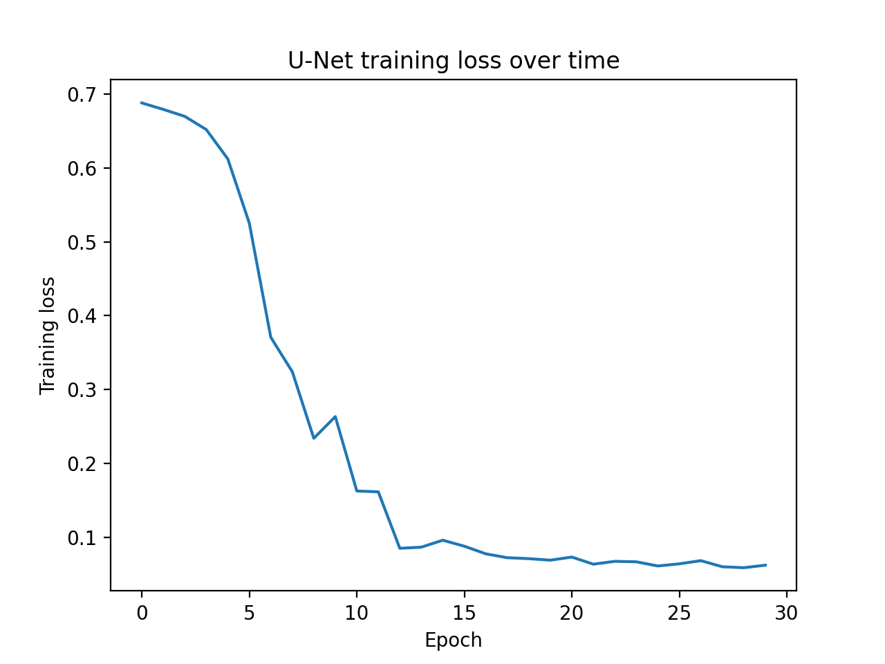
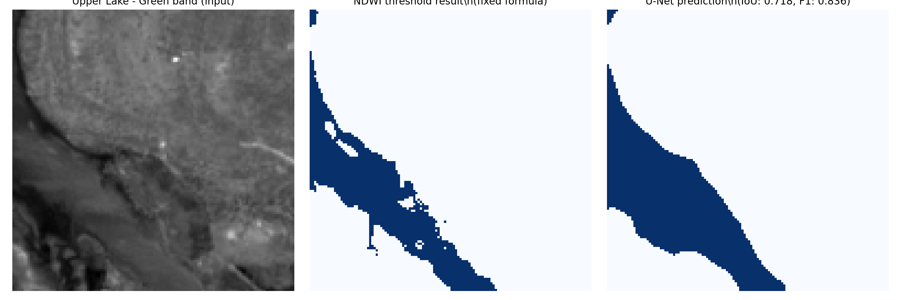

# Water Segmentation with a U-Net — Kolar Dam to Upper Lake (Sentinel-2)

A small U-Net, built from scratch in PyTorch, that labels each pixel of a Sentinel-2 image as water or not-water. It is trained on patches around **Kolar Dam** and tested on **Bhopal's Upper Lake**, a reservoir it never saw during training, to check whether what it learned carries over to a new location.

This is a learning-and-demonstration project. The labels come from NDWI, so the result measures how closely the model reproduces NDWI on a new lake, not how well it finds true water. See [What this does and doesn't show](#what-this-does-and-doesnt-show).

## Why this project

My earlier project ([Kolar Dam water-change detection](#related-work)) used NDWI, a fixed formula with one threshold, to find water. This project asks the follow-up question: can a model learn that pattern from examples instead, and does it still work on a different lake without retuning a threshold?

## Data

- **Imagery:** Sentinel-2 Surface Reflectance (`COPERNICUS/S2_SR_HARMONIZED`), accessed through Google Earth Engine
- **Date:** May 2023, a median composite of cloud-masked images within ±15 days of 15 May (images under 20% cloud cover)
- **Input bands:** Green (B3) and Near-Infrared (B8), 10 m resolution
- **Training patches:** 5 patches of roughly 1.3 km × 1.3 km placed around Kolar Dam, chosen so each contains a mix of water and land (water fraction between 0.30 and 0.67)
- **Test patch:** 1 patch over Upper Lake, Bhopal, never used in training
- **Labels:** NDWI = (Green − NIR) / (Green + NIR), thresholded at 0.1

## Method

1. Pull each patch from Earth Engine as a NumPy array (Green and NIR bands)
2. Generate water / not-water labels with NDWI > 0.1
3. Normalize each patch to a 0–1 range and resize to 128 × 128 (bilinear for images, nearest-neighbour for labels)
4. Train a small U-Net: two encoder levels (16 and 32 channels), a 64-channel bottleneck, a decoder with skip connections, and a 1×1 output layer. 116,897 parameters in total
5. Train with Adam (learning rate 1e-3) and binary cross-entropy loss for 30 epochs, batch size 2
6. Evaluate on the held-out Upper Lake patch with IoU and F1

Training loss fell from about 0.69 (close to random guessing) to about 0.07 over 30 epochs.

## Results

On the held-out Upper Lake patch, compared against the NDWI mask for the same patch:

| Metric | Score |
|--------|-------|
| IoU    | 0.651 |
| F1     | 0.788 |

The model reproduces the NDWI water mask on an unseen lake with moderate-to-good agreement after training on only five patches from a different reservoir. It does not beat NDWI, and it is not designed to: the training labels are NDWI's own output.

## What this does and doesn't show

**Shows**
- A complete segmentation pipeline: real satellite data, labels, a PyTorch Dataset and DataLoader, a U-Net with skip connections written out layer by layer, a training loop, and IoU/F1 evaluation
- A held-out-location test, which is a stricter check than scoring on the training reservoir

**Does not show**
- That a model is better than NDWI. Both the training labels and the test labels come from the same NDWI threshold, so IoU measures imitation of NDWI, not accuracy against real water
- Reliability. This is a single training run on five patches, one date and one test lake, with no repeated runs, so I can't say how much the score would vary
- Robustness. Each patch was normalized on its own min and max, which can shift values between locations, and resizing to 128 × 128 slightly changes pixel scale

## Limitations

- Very small training set (5 patches)
- One season and one year (May 2023)
- Only two input bands
- No separate validation split during training, so no early stopping or tuning
- No independent ground truth
- A single test location

## Possible extensions

- Many more patches across several reservoirs and years, with a proper train / validation / test split
- Independent reference labels (for example JRC Global Surface Water) in place of NDWI-derived ones
- More input bands (blue, SWIR) and a global normalization scheme
- Compare against Segment Anything boundaries on the same lake
- Repeat runs with different seeds and report the spread

## How to run

1. Open `unet_water_segmentation.ipynb` in Google Colab (a free GPU is optional; CPU is enough at this size)
2. Create a free Google Earth Engine account and a Cloud project, and put your own project ID in the `ee.Initialize(project=...)` cell
3. Run the cells in order. Authentication opens a browser login the first time

## Stack

Google Earth Engine (Python API), geemap, NumPy, PyTorch, scikit-learn, Matplotlib

## Related work

- Kolar Dam water-change detection (2019–2025, NDWI and rainfall lag): https://github.com/Saanctity/Kolar-dam-water-change-detectionb
